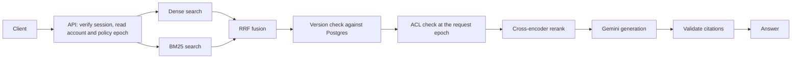
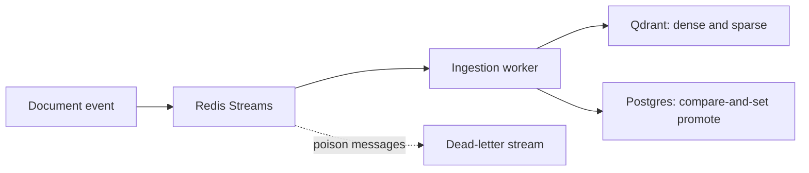

# Vault: secure multi-tenant RAG

A retrieval-augmented question-answering service built around one rule: **the vector index is
never the security authority.** Tenant isolation, document versions, deletes, permission
revocations and account state are enforced from authoritative state at query time, so an eventually
consistent index cannot leak data.

Every guarantee below names the file that implements it and the test or measurement that proves it.
Design rationale is in [DESIGN.md](DESIGN.md).

## Screenshots

<!-- TODO: add screenshots (Home, Ask with citations, Security revocation, Lifecycle, Users, Audit, Operations) -->

## Architecture





Everything is behind a port (a Python `Protocol`) in `backend/src/domain/ports.py`. Adapters in
`backend/src/adapters/` implement them: Postgres, Qdrant, fastembed, Gemini on Vertex, Redis
Streams, plus in-memory fakes. The domain, ingestion and serving code never import an adapter.

## Accounts and roles

People sign in with a username and password created by a platform administrator, much like IAM
users: the server generates a one-time temporary password, and it must be changed at first sign-in.
Passwords are hashed with scrypt (`backend/src/domain/accounts.py`). Accounts are checked against
Postgres on every request, so disabling an account, resetting a password or changing groups takes
effect immediately (`backend/src/serving/accounts_check.py`).

| Role | Can | Cannot |
|---|---|---|
| User | Ask questions over documents their groups may read | Manage anything |
| Group administrator | Manage documents their group can read: upload, edit, delete, share | Purge, remove their own group, read the audit log |
| Tenant administrator | Manage every document in their tenant, purge, read their tenant's audit log | Reach another tenant |
| Platform administrator | Create and manage accounts, see platform health, evaluation and account audit | Read or change any tenant's documents or access lists |

Administrators manage documents but never read them: no admin route returns document text. A
platform administrator provisions identities and runs the platform, and tenant data stays the
tenant's own. Every administrative change writes an audit entry first and is refused if the entry
can't be written; denied attempts and sign-ins are recorded too
(`backend/src/serving/admin.py`, `backend/src/adapters/postgres_audit.py`).

## Guarantees and how they are proven

| Guarantee | Mechanism | Where | Evidence |
|---|---|---|---|
| A stale or half-written version is never served | Chunks are written first, then one conditional `UPDATE` promotes the version | `backend/src/adapters/postgres_doc_state.py`, `backend/src/ingestion/worker.py` | 40 concurrent promotes converge to the highest version (Postgres race test) |
| Duplicate, delayed and reordered events are safe | Idempotent chunk IDs plus compare-and-set | `backend/src/ingestion/worker.py`, `backend/src/ingestion/consumer.py` | `backend/tests/test_ingestion_worker.py`, `backend/tests/test_redis_events.py` |
| A deleted document disappears immediately | Tombstone in the commit point, checked at query time | `backend/src/serving/query_service.py` | `backend/tests/test_query_service.py` |
| Deleted content can be erased | Purge removes chunks, ACL and queued events, keeping a content-free tombstone | `backend/src/ingestion/purge.py` | `backend/tests/test_purge.py` |
| A revoked group loses access on the next request | Global policy epoch; the reader fails closed if it is behind | `backend/src/adapters/postgres_acl.py` | Revocation probe: 3/3 blocked on the first request |
| Tenants cannot see each other's data | Mandatory tenant filter, re-checked in the service | `backend/src/adapters/qdrant_stores.py`, `backend/src/serving/query_service.py` | Permission audit: 121 requests, 0 violations |
| The client cannot choose its identity, groups or epoch | Signed session; groups read from the live account; epoch read server-side | `backend/src/serving/auth.py`, `backend/src/serving/auth_service.py` | `backend/tests/test_identity_accounts.py` |
| Admin power is scoped by role | Role checks on every admin route, enforced in the backend | `backend/src/serving/admin_auth.py`, `backend/src/serving/admin.py` | `backend/tests/test_admin_roles.py`, `backend/tests/test_admin_groups.py` |
| The answer only cites what was retrieved | Citations validated against retrieved chunks | `backend/src/serving/answer_service.py` | Hallucination 0.000 on 120 questions |
| Retrieved text cannot steer the model | Fixed system prompt, escaped source blocks, no tools | `backend/src/serving/answer_service.py`, `backend/src/mcp_server/server.py` | `backend/tests/test_answer_service.py`, `backend/tests/test_mcp_server.py` |
| Failures degrade instead of crash | Per-stage timeouts and fallbacks | `backend/src/serving/query_service.py`, `backend/src/adapters/chaos.py` | Chaos run: 10/10 scenarios |
| A multi-part question can't widen access | Each sub-question runs through the full authorized retrieval path; a permission failure in any part fails the request | `backend/src/serving/planner.py` | `backend/tests/test_planner.py` |
| Uploaded files can't smuggle in more than text | Type detection from content, size, page, unzipped-size and text caps; parsing runs in a bounded thread; originals are stored before the document goes live | `backend/src/adapters/file_parsers.py`, `backend/src/serving/admin.py` | `backend/tests/test_file_parsers.py`, `backend/tests/test_admin_files.py` |

## Results

All numbers are from a **MacBook Air M4, 16 GB**, embedded Qdrant, Postgres and Redis via
Homebrew, a synthetic corpus of **120 documents** (3 tenants × 40), and Gemini on Vertex AI called
from India. They show behaviour, not production capacity. See *Limits*.

**Retrieval** (120 queries, document-level)

| Recall@5 | Recall@10 | MRR | nDCG@10 | Latency p50 / p95 |
|---|---|---|---|---|
| 1.000 | 1.000 | 0.918 | 0.939 | 72 ms / 101 ms |

**Answers** (120 questions: 90 answerable, 30 unanswerable)

| Correct | Cites right document | Correctly refused | Hallucination | Latency p50 / p95 |
|---|---|---|---|---|
| 0.989 (89/90) | 0.989 | 1.000 (30/30) | 0.000 | 903 ms / 1364 ms |

Scoring is exact, with no LLM judge, because the corpus is synthetic and the true answers are
known. Individual queries flip between runs: the same question gave 2 refusals and 3 correct
answers over 5 calls, even at temperature 0. Quote correctness as a rate, not a certainty.

**Security**

| Check | Result |
|---|---|
| Permission audit (every group of every tenant, a no-access group, an unknown tenant) | 121 requests, 0 violations |
| Revocation: `set_acl` returns, then the next request is checked | 3/3 blocked on the first request, worst 26 ms |

The 26 ms is one request's latency, not propagation delay, because the reader queries the primary.
A lagging replica would fail closed with a 503 instead.

**Load** (`/search` only, Locust on the same machine as the server)

| Users | Throughput | p50 | p95 | p99 | Failures |
|---|---|---|---|---|---|
| 10 | ~13 req/s | 33 ms | 63 ms | 76 ms | 0 / 752 |
| 20 | ~25 req/s | 39 ms | 81 ms | 110 ms | 0 / 1,367 |
| 40 | ~47 req/s | 90 ms | 200 ms | 250 ms | 0 / 2,330 |

Throughput stops growing at 40 users while p50 more than doubles, which is where requests start
queueing. The likely bottleneck is the CPU reranker; that is a hypothesis, not a measurement. These
runs predate per-request account checks, which add one indexed Postgres lookup per request, so
re-measure before quoting them.

**Latency breakdown of `/ask`** (p50): retrieval 44 ms (embed 13, rerank 24, everything else under
6), generation about 890 ms. Retrieval is about 5% of the request.

**Resilience** (`backend/src/eval/chaos.py`, fault injection through wrappers around the same ports)

| Scenario | Behaviour |
|---|---|
| reranker down or slow | answer still returned, fused order, reported as degraded |
| dense or lexical down | the other retriever carries the request |
| both retrievers down | 503, no answer in the body |
| document-state store down | 503, fail closed |
| ACL store down | 503, fail closed |
| LLM down or slow | 200 with sources only, `grounded: false` |

**Real VM benchmark:** not run yet. It will hold the first publishable p95, with Locust on a
separate machine and the server in the same region as the model.

## Bugs the process found

- **Qdrant tenant collision.** Point IDs were derived from the chunk ID alone, so two tenants using
  the same document ID would overwrite each other. Found in review, then pinned by a regression test.
- **`grounded: true` on refusals.** Refusals scored 0.00 to 0.30 before the fix and 1.000 after
  (`backend/src/serving/answer_service.py`).
- **Unhandled 500 when the state store was down.** Found while designing the chaos scenarios; it is
  now a 503 that fails closed.
- **Cold-start LLM timeout.** The chaos baseline failed on the first request. Fixed with a startup
  warm-up.
- **Gemini tail latency.** Answer p95 went from 2443 ms to 1364-1581 ms after disabling hidden
  thinking and adding retry plus hedging (`backend/src/adapters/resilient_llm.py`).
- **Document text readable through an admin endpoint.** The dead-letter view returned raw queue
  events, which carry document text, contradicting "administrators manage, they don't read". It now
  strips the field.
- **Operational slips in my own tooling:** an exported `RAG_CHAOS` leaked into a JWT server and
  mounted an unauthenticated endpoint; a stray token made a load test fail every request. Both are
  fixed in `backend/src/cli/main.py` and `backend/infra/locustfile.py`.
- **Test clock in 1970.** A fake clock started at epoch 1,000,000, so tokens it issued were already
  expired when the real clock checked them. Three tests failed from that one line.

## Quickstart

Requires Python 3.12+, Node 20+, Postgres 16 and Redis for the full stack.

```bash
cd backend
pip install -e ".[dev,real,agent,load]"
rag serve --memory                      # in-memory demo, no services, no sign-in
rag doctor                              # checks Postgres, Redis, GCP

createdb rag && createdb rag_test       # full stack
export RAG_JWT_SECRET=<32+ characters>
export RAG_ADMIN_KEY=<32+ characters>
export RAG_BOOTSTRAP_ADMIN_USER=platform
export RAG_BOOTSTRAP_ADMIN_PASSWORD=<12+ characters>
rag serve --jwt --admin                 # add --llm fake to skip Gemini

rag seed-users --password <12+ characters>   # demo accounts: t1-eng, t1-eng-admin, t1-admin, platform ...
rag load --tenants 3 --docs 40          # publishes a synthetic corpus through Redis
rag eval --revocation                   # run against a server started WITHOUT --jwt
rag test --all                          # pytest, mypy --strict, ruff
```

Only one server can run at a time with embedded Qdrant. `rag token --username <name>` signs in and
prints a session token, for the MCP server and load tests.

## Frontend

`frontend/` is a Next.js app (App Router, Tailwind, shadcn/ui). The browser never calls the backend
directly: route handlers in `frontend/src/app/api/` forward calls with the session cookie, and the
frontend holds no secrets. `frontend/src/proxy.ts` sends signed-out visitors to the sign-in page.

```bash
cd frontend && npm run dev                # http://localhost:3000
```

`frontend/.env.local` needs only `BACKEND_URL`. The sidebar adapts to the role: users get Ask,
tenant and group administrators get Documents, Upload, Lifecycle and Security, and platform
administrators get Users, Operations, Evaluation and Audit. The **Lifecycle** page demonstrates
versions, tombstones and out-of-order events on a throwaway document.

## Layout

| Path | Contents |
|---|---|
| `backend/src/domain/` | Models, ports, accounts, fusion, tracing. No third-party imports beyond the standard library. |
| `backend/src/adapters/` | Postgres, Qdrant, fastembed, Gemini, Redis, fault injectors, fakes |
| `backend/src/ingestion/` | Worker, consumer, reconciler, purge, scheduler, synthetic corpus |
| `backend/src/serving/` | API, sessions, admin routes, query and answer services |
| `backend/src/eval/` | Metrics, scoring, runner, regression gate, chaos runner |
| `backend/src/mcp_server/` | MCP server exposing secure search; no identity parameters on its tools |
| `backend/src/cli/` | The `rag` command |
| `backend/tests/` | Unit, integration and fault-injection tests |
| `frontend/src/` | Pages, session handling and the API proxy |

## Limits

- **Scale.** The corpus is 120 synthetic documents. Nothing here proves 10 million; DESIGN.md has
  back-of-envelope capacity math, labelled as such.
- **Single machine.** Load generator and server shared one laptop, and Qdrant ran embedded.
- **Accounts.** Only platform administrators create accounts, with no email, self-service reset or
  MFA, and the group list in the UI is fixed to `eng`, `hr` and `fin`. Sessions last 8 hours.
- **Admins don't read.** An administrator who also needs to ask questions needs a second, ordinary
  account.
- **ACL filtering happens after search**, so a user who may read few documents could get fewer than
  `top_k` results. The query service widens the candidate set (40, then 160, then 400) when the checks
  discard too many, and reads live permissions each round (`backend/src/serving/query_service.py`).
  Group IDs are deliberately not copied into the index, since copies go stale after a grant. A user
  with access to very few documents in a very large corpus can still get fewer results once the cap
  is reached.
- **Lexical statistics span tenants in the shared pool.** BM25 IDF is collection-wide in Qdrant, so
  pooled tenants' rankings are affected by each other's term counts, though content never crosses
  tenants. A tenant can be given its own collections (`RAG_SILO_TENANTS`), which gives it clean
  statistics; `rag migrate-tenant` moves existing data. Each silo adds a collection, so it suits a few
  large tenants (`backend/src/adapters/tenant_routing.py`).
- **One ACL epoch row serializes ACL writes.** Fine for ACL change rates; the next step is batching
  or a Zanzibar-style store.
- **Reads are only partly audited.** Administrative changes, denials, sign-ins and some admin reads
  are recorded. End-user searches and questions are not.
- **Gemini is not deterministic**, and the eval corpus is synthetic, so scores will not transfer to
  real documents without a human-labelled set.
- **Query routing is a heuristic.** A rule decides whether a question looks multi-part, and only then
  does the model try to split it (`backend/src/domain/router.py`, `backend/src/serving/planner.py`).
  It misses some multi-part questions by design, because every routed question costs an extra model
  call. Streamed text is provisional: citations are validated on the complete answer, and the final
  event replaces the streamed text if they differ.
- **File upload is text-only.** PDF, DOCX, TXT and Markdown are accepted (10 MB, 200,000
  characters). Scanned PDFs, encrypted PDFs, images and `.doc` are not, there is no OCR, and Word
  headers, footers and the order of tables relative to paragraphs are not preserved. Text a viewer
  wouldn't show, such as white-on-white, is extracted like the rest, so uploaded files are as
  untrusted as any other source (`backend/src/adapters/file_parsers.py`).
- **Stored files are not encrypted.** Originals and extracted text sit in a local directory
  (`RAG_BLOB_DIR`), behind a port a cloud bucket would implement. Delete hides a document; purge
  removes the stored files along with its chunks, access list and queued events.

## Status

Ingestion, retrieval, authorization, accounts and roles, orchestration, evaluation, fault injection,
the MCP server and the UI are built and tested. Pending: the VM benchmark, an agent on the MCP tools, and an embedder fine-tune.

