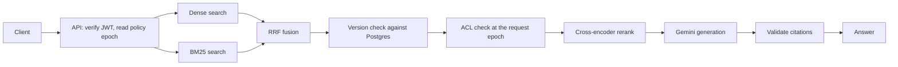
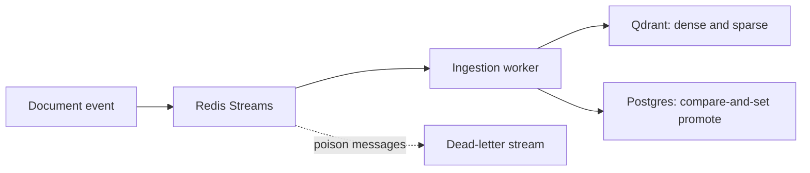

# Secure multi-tenant RAG

A retrieval-augmented question-answering service built around one rule: **the vector index is
never the security authority.** Tenant isolation, document versions, deletes and permission
revocations are all enforced from authoritative state at query time, so an eventually consistent
index cannot leak data.

Built to be explained in an interview: every guarantee below names the file that implements it and
the test or measurement that proves it. Design rationale is in [DESIGN.md](DESIGN.md).

## Architecture





Everything is behind a port (a Python `Protocol`) in `backend/src/domain/ports.py`. Adapters in
`backend/src/adapters/` implement them: Postgres, Qdrant, fastembed, Gemini on Vertex, Redis Streams, plus
in-memory fakes. The domain, ingestion and serving code never import an adapter.

## Guarantees and how they are proven

| Guarantee | Mechanism | Where | Evidence |
|---|---|---|---|
| A stale or half-written version is never served | Chunks are written first, then one conditional `UPDATE` promotes the version | `backend/src/adapters/postgres_doc_state.py`, `backend/src/ingestion/worker.py` | 40 concurrent promotes converge to the highest version (Postgres race test) |
| Duplicate, delayed and reordered events are safe | Idempotent chunk IDs plus compare-and-set | `backend/src/ingestion/worker.py`, `backend/src/ingestion/consumer.py` | `backend/tests/test_ingestion_worker.py`, `backend/tests/test_redis_events.py` |
| A deleted document disappears immediately | Tombstone in the commit point, checked at query time | `backend/src/serving/query_service.py` | `backend/tests/test_query_service.py` |
| A revoked group loses access on the next request | Global policy epoch; the reader fails closed if it is behind | `backend/src/adapters/postgres_acl.py` | Revocation probe: 3/3 blocked on the first request |
| Tenants cannot see each other's data | Mandatory tenant filter, re-checked in the service | `backend/src/adapters/qdrant_stores.py`, `backend/src/serving/query_service.py` | Permission audit: 121 requests, 0 violations |
| The client cannot choose its own epoch or groups | Verified JWT; epoch read server-side | `backend/src/serving/auth.py` | `backend/tests/test_auth.py` |
| The answer only cites what was retrieved | Citations validated against retrieved chunks | `backend/src/serving/answer_service.py` | Hallucination 0.000 on 120 questions |
| Retrieved text cannot steer the model | Fixed system prompt, escaped source blocks, no tools | `backend/src/serving/answer_service.py`, `backend/src/mcp_server/server.py` | `backend/tests/test_answer_service.py`, `backend/tests/test_mcp_server.py` |
| Failures degrade instead of crash | Per-stage timeouts and fallbacks | `backend/src/serving/query_service.py`, `backend/src/adapters/chaos.py` | Chaos run: 10/10 scenarios |

## Results

All numbers below are from a **MacBook Air M4, 16 GB**, embedded Qdrant, Postgres and Redis via
Homebrew, a synthetic corpus of **120 documents** (3 tenants × 40), and Gemini on Vertex AI called
from India. They show behaviour, not production capacity. See *Limits*.

**Retrieval** (120 queries, document-level)

| Recall@5 | Recall@10 | MRR | nDCG@10 | Latency p50 / p95 |
|---|---|---|---|---|
| 1.000 | 1.000 | 0.918 | 0.939 | 72 ms / 101 ms |

**Answers** (120 questions: 90 answerable, 30 unanswerable)

| Correct | Cites right document | Correctly refused | Hallucination | Latency p50 / p95 |
|---|---|---|---|---|
| 0.989 (89/90) | 0.989 | 1.000 (30/30) | 0.000 | 903 ms / 1364 ms |

Scoring is exact, with no LLM judge, because the corpus is synthetic and the true answers are
known. Individual queries flip between runs: the same question gave 2 refusals and 3 correct
answers over 5 calls, even at temperature 0. Quote correctness as a rate, not a certainty.

**Security**

| Check | Result |
|---|---|
| Permission audit (every group of every tenant, a no-access group, an unknown tenant) | 121 requests, 0 violations |
| Revocation: `set_acl` returns, then the next request is checked | 3/3 blocked on the first request, worst 26 ms |

The 26 ms is one request's latency, not propagation delay, because the reader queries the
primary. A lagging replica would fail closed with a 503 instead.

**Load** (`/search` only, Locust on the same machine as the server)

| Users | Throughput | p50 | p95 | p99 | Failures |
|---|---|---|---|---|---|
| 10 | ~13 req/s | 33 ms | 63 ms | 76 ms | 0 / 752 |
| 20 | ~25 req/s | 39 ms | 81 ms | 110 ms | 0 / 1,367 |
| 40 | ~47 req/s | 90 ms | 200 ms | 250 ms | 0 / 2,330 |

Throughput stops growing at 40 users while p50 more than doubles, which is where requests start
queueing. The likely bottleneck is the CPU reranker; that is a hypothesis, not a measurement.

**Latency breakdown of `/ask`** (p50): retrieval 44 ms (embed 13, rerank 24, everything else
under 6), generation about 890 ms. Retrieval is about 5% of the request.

**Resilience** (`backend/src/eval/chaos.py`, fault injection through wrappers around the same ports)

| Scenario | Behaviour |
|---|---|
| reranker down or slow | answer still returned, fused order, reported as degraded |
| dense or lexical down | the other retriever carries the request |
| both retrievers down | 503, no answer in the body |
| document-state store down | 503, fail closed |
| ACL store down | 503, fail closed |
| LLM down or slow | 200 with sources only, `grounded: false` |

**Real VM benchmark:** not run yet. This section will hold the first publishable p95, with Locust
on a separate machine and the server in the same region as the model.

## Bugs the process found

Most of the value of the tests and eval harness is what they exposed:

- **Qdrant tenant collision.** Point IDs were derived from the chunk ID alone, so two tenants using
  the same document ID would overwrite each other. Found in code review, then pinned by a
  regression test; the in-memory fakes had the same flaw.
- **`grounded: true` on refusals.** The first eval showed the model saying "I don't have enough
  information" while still citing a source. Refusals scored 0.00 to 0.30 before the fix and 1.000
  after (`backend/src/serving/answer_service.py`).
- **Unhandled 500 when the state store was down.** Found while designing the chaos scenarios; it is
  now a 503 that fails closed.
- **Cold-start LLM timeout.** The chaos baseline failed on the first request. Fixed with a
  startup warm-up.
- **Gemini tail latency.** Answer p95 went from 2443 ms to 1364-1581 ms after disabling hidden
  thinking and adding retry plus hedging (`backend/src/adapters/resilient_llm.py`).
- **Operational slips in my own tooling:** an exported `RAG_CHAOS` leaked into a JWT server and
  mounted an unauthenticated endpoint; a stray `RAG_TOKEN` made a load test fail every request.
  Both are fixed in `backend/src/cli/main.py` and `backend/infra/locustfile.py`.

## Quickstart

Requires Python 3.12+, and for the full stack Postgres 16 and Redis.

```bash
cd backend
pip install -e ".[dev,real,agent,load]"

rag serve --memory                      # no services needed, in-memory demo
rag doctor                              # checks Postgres, Redis, GCP

createdb rag && createdb rag_test       # full stack
rag serve --llm fake                    # or: rag serve   (Gemini; needs GCP_PROJECT)
rag load --tenants 3 --docs 40          # publishes a synthetic corpus through Redis
rag eval --revocation                   # retrieval, answers, permission audit, revocation, gate
rag serve --chaos & rag chaos-run       # fault injection (never enable in production)
RAG_LOAD_ASK=0 rag loadtest -u 20       # Locust, /search only
rag test --all                          # pytest, mypy --strict, ruff
```

Only one server can run at a time with embedded Qdrant.

## Frontend

`frontend/` is a Next.js app (App Router, Tailwind, shadcn/ui). The browser never calls the
backend directly: route handlers in `frontend/src/app/api/` hold the JWT secret and admin key,
mint a 5-minute token for the chosen demo persona, and proxy the call.

“The Lifecycle page demonstrates versions, tombstones and out-of-order events on a throwaway document.”

```bash
cd backend && rag serve --jwt --admin     # terminal 1
cd frontend && npm run dev                # terminal 2, http://localhost:3000
```

`frontend/.env.local` needs `BACKEND_URL`, `RAG_JWT_SECRET` (same as the backend) and
`RAG_ADMIN_KEY`. Setting `APP_ACCESS_PASSWORD` puts a password screen in front of the whole UI
(`frontend/src/middleware.ts`). The persona picker is a demo identity switcher, not authentication.

## Layout

| Path | Contents |
|---|---|
| `backend/src/domain/` | Models, ports, fusion, tracing. No third-party imports. |
| `backend/src/adapters/` | Postgres, Qdrant, fastembed, Gemini, Redis, fault injectors, fakes |
| `backend/src/ingestion/` | Worker, consumer, reconciler, reindexer, synthetic corpus |
| `backend/src/serving/` | API, auth, query and answer services |
| `backend/src/eval/` | Metrics, scoring, runner, regression gate, chaos runner |
| `backend/src/mcp_server/` | MCP server exposing secure search; no identity parameters on its tools |
| `backend/src/cli/` | The `rag` command |
| `backend/tests/` | Unit, integration and fault-injection tests |
| `backend/infra/` | Locust load test |

## Limits

Stated so nobody has to find them:

- **Scale.** The corpus is 120 synthetic documents. Nothing here proves 10 million; DESIGN.md has
  back-of-envelope capacity math, labelled as such.
- **Single machine.** Load generator and server shared one laptop, and Qdrant ran embedded.
- **Group changes.** Groups come from the JWT, so a membership change applies when the token
  expires. Document ACL changes are immediate.
- **ACL filtering happens after search**, so a user with access to few documents can get fewer
  than `top_k` results. Pushing group IDs into the Qdrant filter is the planned fix.
- **Lexical statistics span tenants.** BM25 IDF is collection-wide in Qdrant: ranking is
  affected by other tenants' term counts, though content never crosses tenants.
- **One ACL epoch row serializes ACL writes.** Fine for ACL change rates; the next step is
  batching or a Zanzibar-style store.
- **Gemini is not deterministic**, and the eval corpus is synthetic, so scores will not transfer
  to real documents without a human-labelled set.
- **No streaming, query routing or decomposition** yet.

## Status

Ingestion, retrieval, authorization, orchestration, evaluation, fault injection and the MCP server
are built and tested. Pending: embedder fine-tune, an agent on the MCP tools, and the VM benchmark.


